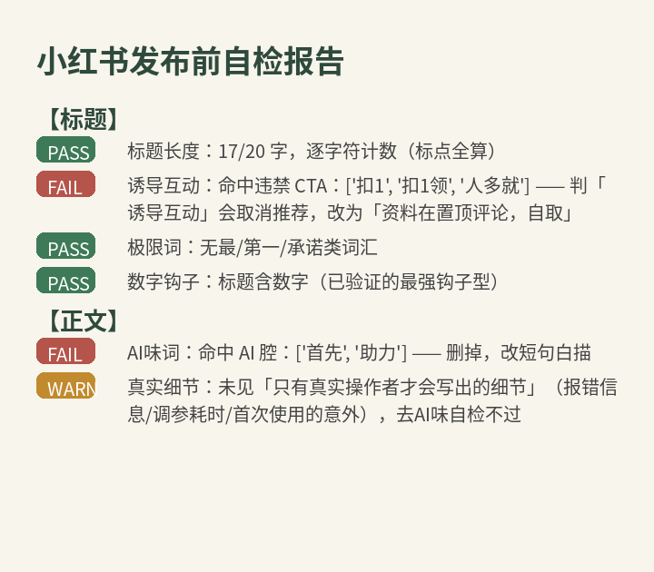

# hotspot-content-forge

**An end-to-end hotspot content forge for AI agents — capture trending topics, turn them into copy, covers, posters, video, and multi-platform posts, automatically.**

**小红书爆款内容引擎：文案钩子、封面物料、视频/音频管线、多平台改写、数据归因——一套装进 AI Agent 的全流程产线规则，全部来自真实账号的爆款与翻车实录。**

[](https://agentskills.io)
[](LICENSE)

---

## What's inside / 内容全景

| Module | File | What it gives the agent |
|---|---|---|
| 核心规则（主技能） | `SKILL.md` | 选题硬门槛、钩子公式、合规红线、发布前四检、数据归因 |
| 封面手册 | `references/cover-playbook.md` | 六大构图模板、文字层级、护眼配色、AI 生图 Prompt 骨架、验收四指标 |
| 物料工厂 | `references/material-factory.md` | PIL 海报模板参数、ffmpeg 标准参数、出片五步终检 |
| 视频管线 | `references/video-maker.md` | GIF / MP4 / BGM / TTS 口播全流程命令、中文字体坑、帧自检 |
| 数据分析 | `references/data-analyst.md` | 读数方法、活性诊断阈值、归因框架、三动作决策树 |
| 多平台改写 | `references/marketing-multiplatform.md` | 平台规则要点、发布清单、七大平台改写差异表 |
| 自检器 | `scripts/xhs_precheck.py` | 发布前合规检查的可执行代码 |
| 视频演示 | `examples/countdown_demo.py` | PIL 逐帧 + ffmpeg 的最小可跑管线 |

## The runnable demos / 可运行演示

### 1. Pre-publish compliance checker（发布前自检器）

```bash
python3 scripts/xhs_precheck.py \
  --title "评论区扣1领模板，人多就整理教程！" \
  --body "首先这个工具非常强大，助力大家提高效率。" \
  --card report.png
# FAIL induced-interaction: matches 扣1 / 人多就 → rewrite as pinned-comment hook
# FAIL AI-flavour: 首先 / 助力
# exit 1 when violations exist — wire into your agent loop or CI
```

Checks: title ≤20 chars (counted char-by-char — punctuation and digits all
count, the platform does not negotiate), banned "comment-to-claim" CTAs,
ad-law superlatives, number-hook presence, AI-flavour words, and whether
the body carries "only a real operator knows this" details.



### 2. Video pipeline（视频管线最小演示）

```bash
python3 examples/countdown_demo.py
# PIL draws 3 CJK frames -> GIF + MP4 (h264, -pix_fmt yuv420p)
```

Verified output: `precheck-demo.mp4` (h264 / yuv420p / 720×400) and a
looping GIF, both shipped in `examples/`.

## The production pipeline / 产稿全流程

```
1. TOPIC      concrete scenario + deliverable solution, or veto
2. HOOK       number contrast line 1, pain amplification by line 6
3. DRAFT      numbered steps, ≤3 lines each; insert real-operator details
4. PRECHECK   xhs_precheck.py gates the draft
5. COVER      playbook templates; per-post params passed explicitly
6. MATERIAL   poster/GIF/MP4/BGM/voiceover per material-factory + video-maker
7. PUBLISH    platform checklists; comments = requirement backlog
8. ANALYZE    data-analyst thresholds; fix cover/title within 24h ×2–3
9. REWRITE    marketing-multiplatform: one piece, seven platforms
```

## The scar tissue / 实战翻车实录（规则来源）

- A post was de-recommended for "induced interaction" over a
  *comment-to-claim* hook — the compliant pinned-comment rewrite keeps the
  hook without the penalty.
- Titles die at exactly 20 characters, counting everything.
- Invisible throttling signature: >72h old + <500 impressions + ~zero
  engagement + status "normal" + recommendation feed ≈ 0 → set to private,
  re-post a compliant version in a fresh slot.
- Hardcoded cover template text cross-contaminates A/B drafts — per-post
  parameters only.
- ✗ (U+2717) is a tofu box in NotoSansCJK; use ✓ and ×.
- CJK long messages overflow PIL canvases — wrap by `textlength` and
  budget line height before rendering (the demo card does this).

## Installation / 安装

### Claude Code / Claude.ai
```bash
git clone https://github.com/gba-mep/hotspot-content-forge
mkdir -p ~/.claude/skills/
cp -r hotspot-content-forge ~/.claude/skills/

# Claude.ai: zip the folder, then
# Settings > Capabilities > Skills > Upload a skill
# (zip top level must be the folder itself: <name>/SKILL.md)
```

### Other agent runtimes
`SKILL.md` + markdown references — any markdown-reading agent can use it.
The checker script needs stdlib only; the report card and video demo need
Pillow (+ ffmpeg for MP4).

## License

MIT — see [LICENSE](LICENSE).
